# Escape the Old Schoolhouse

**Escape rooms for your class, in the browser.** Students solve short puzzles; you get the grade through a one-question quiz.

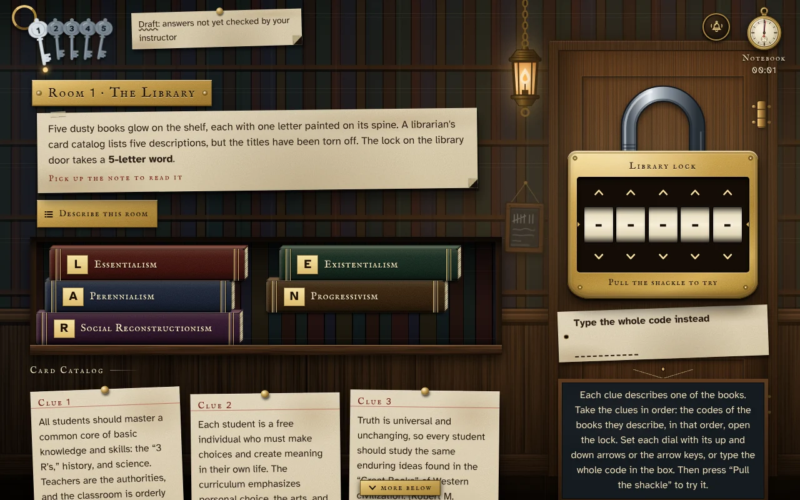

## Start here

### 👉 [Open the website: sbstndalton.github.io/escape-the-old-schoolhouse](https://sbstndalton.github.io/escape-the-old-schoolhouse/)

- **Nothing to install.** It runs in Chrome, Edge, Firefox or Safari.
- **No accounts.** No sign-up for you or your students.
- **Nothing is sent anywhere.** What you write stays on your computer, and the game sends nothing back.

The front page has two doors: one for students, one for teachers.


---

## For teachers: make your own in 3 steps

It takes about 30 to 45 minutes. The maker asks one question per page and saves as you go.

### Step 1. Make it

On the front page, press **Make an escape room**. The maker walks you through 10 short steps. Choose **Change the sample** (to start from the ready-made escape room) or **Start with an empty escape room**, then press **Continue** on each page.

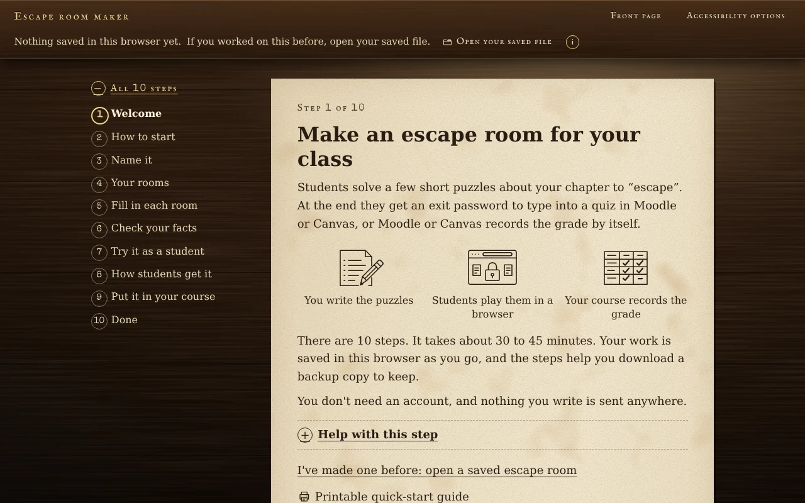

You type your own questions, with other spellings you will accept. Capitals, accents and punctuation don't matter.

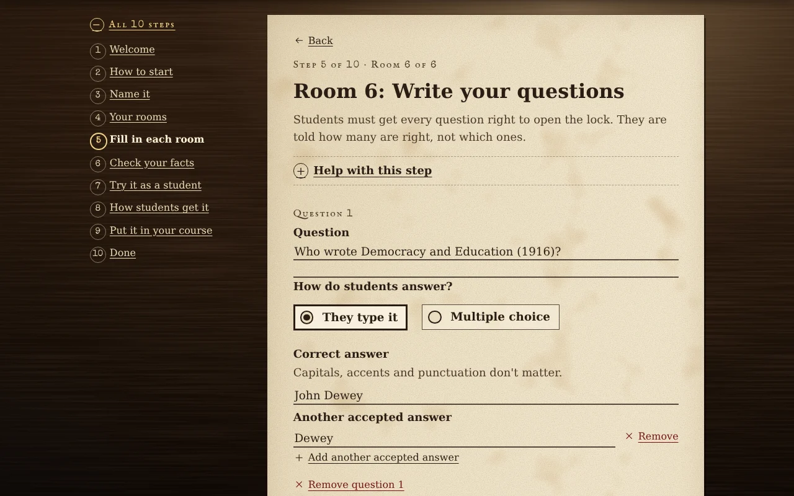

Stuck? Every page has **Help with this step**. Need a break? Press **Save and finish later**.

The maker works on a tablet or phone too: the list of steps folds away under **All 10 steps**.

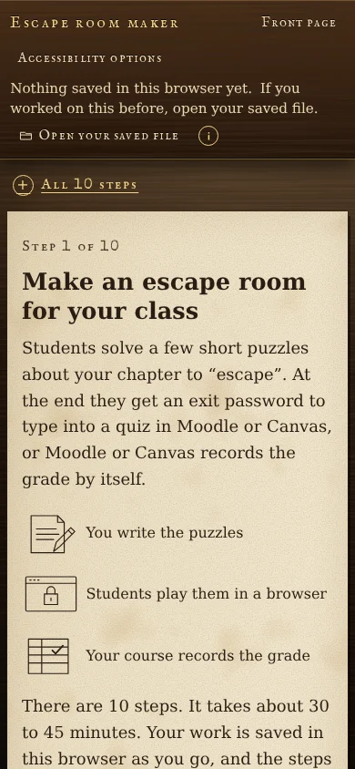

### Step 2. Check your facts and try it

On **Check your facts**, compare each item with your textbook. Type **Where you checked it** and tick **I checked this is correct**. Nothing is ever ticked for you. Until every item is ticked, students see a "Draft" notice.

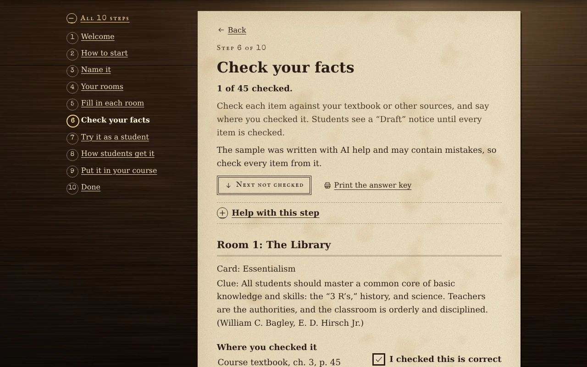

Then, on **Try it as a student**, press **Start the student view** and play it yourself. **Show answers** lets you skip ahead. Press **Esc** or **Exit preview** to come back.

### Step 3. Share the class link and make the exit-password quiz

On **How students get it**, choose **Share a class link (recommended)**.

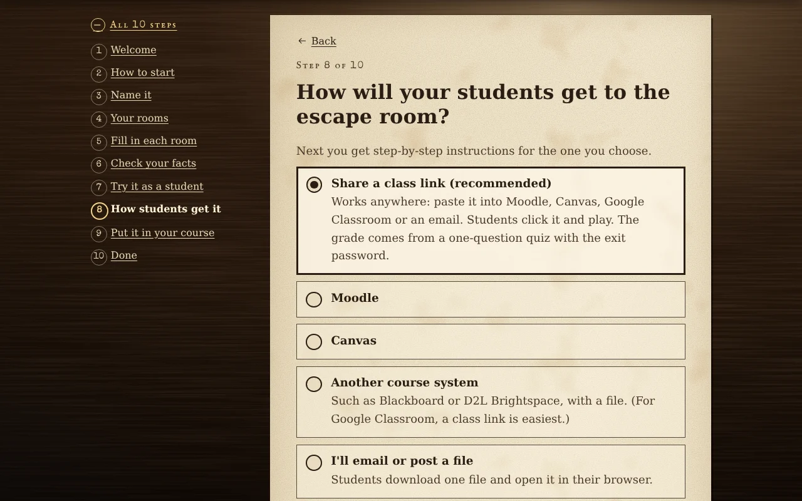

Press **Make the class link**, then **Copy link**. Paste the link into Moodle, Canvas, Google Classroom or an email. The maker shows exactly where it goes in Moodle and Canvas.

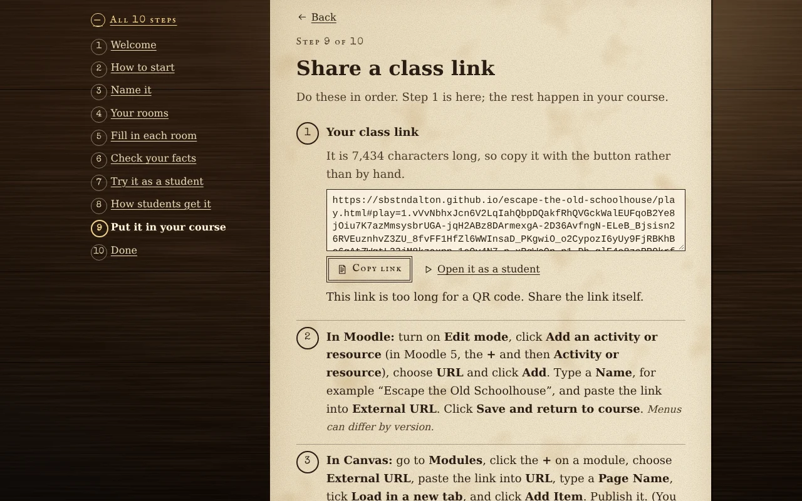

**For the grade**, make a quiz in your course with one question:

> Type the exit password from the certificate at the end of the escape room.

The answer is your exit password (the maker shows it, with a **Copy** button). **Set the quiz to ignore capital letters**, so that, for the sample, `dewey1916` and `DEWEY1916` both count:

- **Moodle:** a **Short answer** question, with **Case sensitivity** set to **No, case is unimportant**.
- **Canvas:** a **Fill in the Blank** question, with **Close enough** and **Spelling only (ignore case)**, or add the password in small letters as a second answer.

Menus can differ by version. If you change the password after students have played, keep the old one as a second correct answer.

### Print the quick-start guide

The **[printable quick-start guide](https://sbstndalton.github.io/escape-the-old-schoolhouse/guide.html)** puts all of this on one page (Letter or A4) to keep beside your screen. Press **Print this guide**.

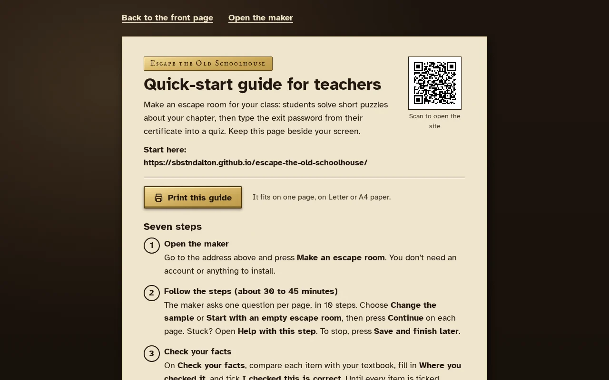

---

## For students

**Click the link your teacher shared.** The escape room opens in your browser. No sign-up.

No link yet? On the [front page](https://sbstndalton.github.io/escape-the-old-schoolhouse/), press **Play the sample escape room**.

1. Type your name and press **Begin**.

   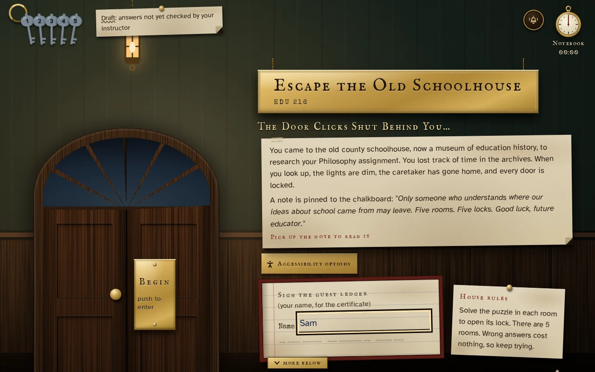

2. Solve each room to open its lock. Read the clues, try an answer, and press the lock's button. Wrong answers cost nothing, so keep trying. When a lock opens, press **Go through the door**.

3. At the end you get a certificate with the **exit password**. Type it into your teacher's quiz.

   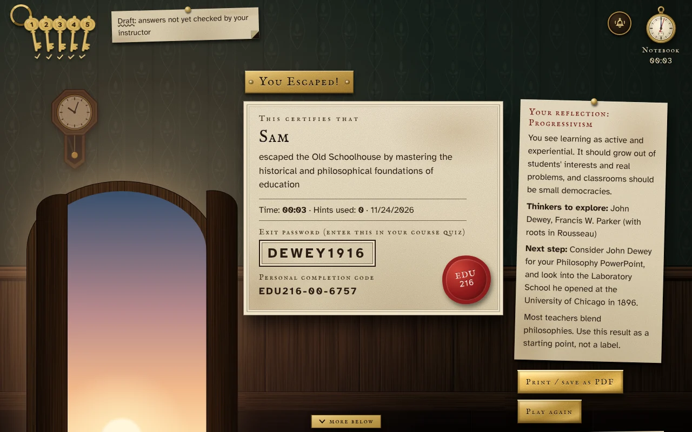

It works on a phone too: the room becomes one column that you scroll.

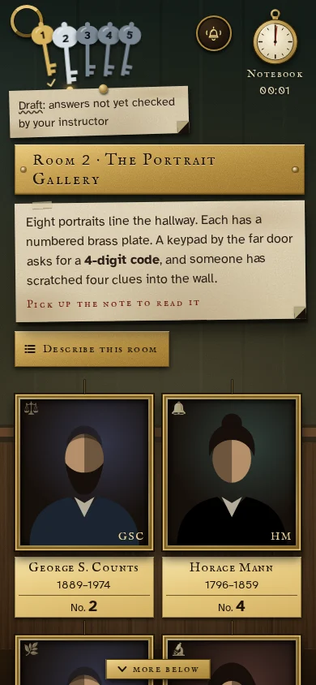

**Good to know:** there is no time limit. The clock only shows how long you have played. The pocket watch (**Notebook**) or the **Esc** key opens settings and lets you start over.

---

## Saving your work

**Your work is saved in this browser only**, on this computer. Another browser or computer won't have it, and clearing your browsing history removes it. So keep a copy:

- Press **Download a backup**. You get one file that plays as the game in any browser and opens again in the maker. Keep it somewhere safe, such as your course folder.
- **Your class link is a backup too.** It holds the whole escape room.

**On a new computer** (or if your work is gone): open the maker and choose **Open one I saved before**. Then pick your backup file, or paste your class link.

**Changed something after sharing?** A class link holds the escape room as it was when you made it. Press **Make a new class link** and share the new one; the old link keeps opening the old version.

---

## Accessibility

Everyone should be able to play and to make an escape room. The goal is [WCAG 2.2](https://www.w3.org/TR/WCAG22/) level AA.

- **A friendly first question.** The first time you open the site, it asks "Before you start: make it easier to use?" with big switches. Each switch works straight away. You can open it again any time with **Accessibility options**.

  

- **Listen buttons.** A small **Listen** button on each paper in the game reads it aloud, using a voice built into the device. Nothing is sent online.
- **High contrast.** Solid backgrounds and strong black-and-white text, with no textures.
- **Readable text.** Bigger, clearer letters with more space between lines and words.
- **Keyboard and screen readers.** Everything works with the keyboard alone (Tab, Enter, Space, arrow keys, Esc) and with screen readers. **Describe this room** lists everything in a room as plain text. Your browser's text size and zoom are respected.
- **Motion and sound are optional**, and every sound also comes with words on screen.
- **No time limit.** The clock can be hidden.

More:

- [The full accessibility statement](ACCESSIBILITY.md): what was tested, measured contrast, and what still falls short ([as a web page](https://sbstndalton.github.io/escape-the-old-schoolhouse/accessibility.html)).
- [Test it with a real screen reader: step-by-step script](SCREEN-READER-TESTS.md).

---

## The sample escape room

The sample is **"Escape the Old Schoolhouse"**, for an introductory **Foundations of Education** course: 5 rooms about philosophies and philosophers of education, ending with a reflection on your own philosophy. It takes about 15 to 25 minutes.

1. **The Library:** match five philosophies to their descriptions (books on a shelf and a padlock).
2. **The Portrait Gallery:** match clues to thinkers.
3. **The History Hall:** put events in order on a timeline.
4. **The Observation Room:** stamp classroom scenes as traditional or progressive.
5. **The Mirror:** a short reflection survey with no wrong answers.

> **The sample has not been checked yet.** It was written with AI help and may contain mistakes. Until the instructor checks every item in the maker, students see a **"Draft"** notice at the top of the game. Some facts also vary between sources (for example, *The Republic* is usually dated 380 to 370 BCE, and Freire wrote *Pedagogy of the Oppressed* around 1967 to 1968), so check them against your own textbook.

The exit password on the sample's certificate is **`DEWEY1916`** (John Dewey's *Democracy and Education*, 1916). It is the same for every student, so a quiz can grade it automatically.

<details>
<summary><b>Sample answer key (instructors only)</b></summary>

| Room | Puzzle | Answer |
|---|---|---|
| 1 · The Library | Match 5 philosophies to their descriptions | **LEARN** |
| 2 · The Portrait Gallery | Match clues to Dewey, Montessori, Freire and Mann | **9154** |
| 3 · The History Hall | Put the events in order | Plato → Rousseau (1762) → Mann (1837) → Montessori (1907) → Dewey (1916) → Freire (1968) → Adler (1982) |
| 4 · The Observation Room | Label 8 classroom scenes | T, P, T, P, T, P, T, P (top to bottom; T = traditional, P = progressive) |
| 5 · The Mirror | Reflection survey | Any answers. It gives a personal philosophy profile. |

Hints are off in the sample. Rooms 1 to 4 each have two ready-made hints that nudge without giving the answer; you can switch them on per room. The maker's answer key always shows the current answers, also for escape rooms you have changed.

</details>

---

## Other ways to share

<details>
<summary><b>Moodle or Canvas grade file, or a plain file</b></summary>

A class link works everywhere and is the easiest. If you would rather upload a file, choose **Moodle**, **Canvas**, **Another course system** or **I'll email or post a file** on **How students get it**. The maker then gives you the right file and numbered steps. In short:

**A grade file (Moodle or Canvas).** This is a `.zip` package (called SCORM) that your course system opens and grades by itself: students get 100% when they escape. **Don't unzip it.**

- **Moodle:** turn on **Edit mode**, **Add an activity or resource**, choose **SCORM package**, then **Add**. Drag the .zip file into **Package file**, then **Save and display**. If SCORM package isn't in the list, your administrator has switched it off: use the file and quiz instead.
- **Canvas:** look for **SCORM** in your course menu (if it isn't there, try **Settings**, then **Navigation**). Click **SCORM**, **Upload** the .zip file, choose **Import as a graded assignment**, and publish it. If SCORM isn't available at all, ask your Canvas administrator, or use the file and quiz.

**A file and the exit-password quiz.** Download the game file (`.html`) and put it in your course:

- **Moodle:** **Add an activity or resource**, choose **File**, drag in the game file, and set **Display** to **Open**. Then add the one-question quiz.
- **Canvas:** upload it in **Files**, link to it from a **Page**, then add the one-question quiz.
- **Email or another system:** students download the file and double-click it. It opens in their browser and needs no internet. Phones and tablets sometimes show the file as code; ask students to use a computer.

Menus can differ by version. To check it as a student, use **Student View** (Canvas) or **Switch role to…** then **Student** (Moodle).

</details>

---

## Questions

<details>
<summary><b>Questions and troubleshooting</b></summary>

**Do my students need an account?**
No. They click the link and play.

**Is anything stored online?**
No. A class link carries the escape room inside the link itself; the part after `#` never reaches a web server. Your work stays in your browser. With a grade file, only the completion, score and time go to *your own* Moodle or Canvas.

**My work is gone, or I'm on a new computer.**
Open the maker and choose **Open one I saved before**. Pick your backup file, or paste your class link.

**A student says the link doesn't open.**
If it says "This class link is incomplete", part of it was cut off. Copy it again with **Copy link** and paste all of it. If it keeps happening, choose **I'll email or post a file** instead.

**I want to change the exit password.**
Press **Show all settings (Advanced mode)**, open **Finish & grading**, and change **Exit password**. Then make a new class link. In your quiz, keep the old password as a second correct answer.

**Can I make more than one escape room?**
Yes. Every escape room you make is kept in this browser, and none overwrites another. When you come back to the maker, its home page lists them under **Your escape rooms**, with **Make another escape room** and **Make a copy of this one**.

**Can I use other puzzle types?**
Yes. There are five kinds of rooms: **Quiz questions**, **Match clues to cards**, **Put in order (timeline)**, **Sort into groups** and **Reflection (no wrong answers)**. The guided steps fill in the first two; the others, plus hints, looks and grading options, are set up in **Show all settings (Advanced mode)**.

**Can students cheat?**
The answers are only lightly hidden inside the game. A tech-savvy student could dig them out. That's fine for practice and low-stakes quizzes; don't rely on it for high-stakes tests.

**What does the "Draft" notice mean?**
Some items haven't been ticked as checked yet. It disappears when every item is ticked on **Check your facts**.

</details>

---

## For developers

<details>
<summary><b>How it's built, testing, and licences</b></summary>

Everything is plain HTML, CSS and JavaScript. Each page is one self-contained file that works by double-clicking and inside Moodle or Canvas, with no outside requests.

**Files**

| Path | What it is |
|---|---|
| `src/game.html` | The student game engine (draws each room from the content; holds no course content). |
| `src/editor.html` | The maker: the guided steps, and Advanced mode (`editor.html?mode=advanced`). |
| `src/shared.js` | Logic shared by both and by Node: validation, class links, the QR code maker, the SCORM writer, accessibility helpers. |
| `src/front.html`, `src/guide.html`, `src/statement.html` | The front page, the quick-start guide, and the frame of the accessibility statement page. |
| `content/foundations-of-education.json` | The sample escape room's content. |
| `scripts/build.js`, `scripts/serve.js` | The build and a zero-dependency local server. |
| `scripts/readme-shots.js` | Takes the pictures in this README into `docs/images/`. |
| `tests/` | Playwright tests: play-through, class links, editor, guided steps, guide, read aloud, and the accessibility suites. |

**Generated files: never edit them by hand.** `npm run build` makes `index.html` (front page), `play.html` (game with the sample), `editor.html`, `accessibility.html` (from `ACCESSIBILITY.md`), `guide.html`, `EscapeRoom_SCORM.zip` and `imsmanifest.xml`. Commit them; CI fails if they're out of date.

**Commands** (needs [Node.js](https://nodejs.org)):

```bash
npm install                      # once; then: npx playwright install chromium
npm run build                    # rebuild the generated files
npm run serve                    # the site at http://localhost:8080
npm test                         # build, then every test (several minutes)
npm run test:a11y                # only the accessibility tests
node scripts/readme-shots.js     # retake the README pictures (after npm run build)
```

Run `node scripts/readme-shots.js --only maker` to retake only some pictures. Look at them after a visible change.

**Claude Code.** [`CLAUDE.md`](CLAUDE.md) holds the project's rules (layout, accessibility, content accuracy, element ids the tests rely on). `.mcp.json` gives Claude Code the Playwright browser tools, so it can open the site, play it and check its own changes.

**Class links** are `play.html#play=1.<data>`: the content as JSON, compressed (deflate-raw) and base64url-encoded. Link content is treated as untrusted: size-limited, cleaned, validated, and always shown as plain text.

**Licences of what's bundled**

- Fonts, embedded in the pages: Atkinson Hyperlegible, IM Fell English and IM Fell English SC (SIL Open Font License 1.1); Special Elite (Apache License 2.0). Their notices are in the pages' style blocks.
- The QR code encoder in `src/shared.js` is adapted from Project Nayuki's QR Code generator (MIT License; notice inline).

</details>
